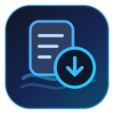

<div align="center">

<p>🌐 &nbsp; <a href="README.md">简体中文</a> &nbsp;·&nbsp; <strong>English</strong></p>



# Azure Drop · 苍蓝流笺

**Zero `app.asar` patching · Zero Token prefix tax · Native drag-and-drop mention pills & lossless PNG clipboard capture for Google Antigravity**

<p>
  
  
  
  
  <a href="./LICENSE"></a>
</p>

</div>

A lightweight, zero-dependency Sidecar input enhancer for **Google Antigravity** using local CDP injection—zero `app.asar` modifications and zero turn-0 token overhead by default (the optional left-sidebar launcher MCP exposes zero tools until enabled).

## Features

1. **Drag & Drop Files/Folders → Native Mention Pills (`📁 Folder/` · `📄 File`)**
   - Resolves exact local paths in 0ms via `window.electronNative.getPathForFile(file)` and inserts clean native Antigravity Lexical `contextScopeItemMention` chips (optionally append full plain path, auto-append a trailing space after insertion, or switch to plain-path mode in the side panel).
   - **Hold `Shift` while dropping** to pass through to Antigravity's native attachment flow.
2. **File Explorer `Ctrl+C` / `Ctrl+V` Insertion**
   - Paste copied local files or folders directly into the chat input as clean native mention pills or absolute paths.
3. **Lossless PNG Clipboard Capture**
   - Intercepts lossy chat-box image compression, transfers raw clipboard bytes over a private local CDP `Runtime.addBinding` bridge into `~/.gemini/antigravity/pasted-images/` with zero re-encoding, and inserts a native file mention pill.
4. **Composer & Sent-Message Image Thumbnails + Lossless Lightbox (Toggleable)**
   - Pasting, dropping, or re-inserting images automatically displays native-style thumbnails above the composer input, and keeps matching right-aligned thumbnails above sent user message bubbles without duplicating native attachments.
   - Click any thumbnail to open a full-resolution lossless lightbox (wheel zoom, pan, double-click 1:1 toggle, multi-image navigation, copy path, open in system viewer); clicking `×` on a composer thumbnail removes the matching editor mention.
5. **Top File-Path Breadcrumb Context Menu (Toggleable)**
   - Right-click any segment of the side-pane file path breadcrumb (`File path breadcrumbs`) to reference it into the chat input, open the folder directly, reveal in system file manager, or copy its full local path.
6. **Sidecar Gallery & Auto-Cleanup**
   - Browse recent lossless screenshots, re-insert any image into the active chat box with one click, copy paths, open the storage folder, and auto-prune expired images.

## Quick Start

> Prerequisite: **Node.js >= 22.0.0** and Antigravity launched with `--remote-debugging-port=0`.

```powershell
# Windows (PowerShell)
git clone https://github.com/A16Nights/antigravity-azure-drop.git "$env:USERPROFILE\.gemini\config\plugins\azure-drop"

# macOS / Linux
git clone https://github.com/A16Nights/antigravity-azure-drop.git ~/.gemini/config/plugins/azure-drop
```

Reload Antigravity (`Ctrl+R`) and enable **Azure Drop** in **Plugins**.

## Azure Suite Ecosystem

All **10 Azure Suite plugins** share a unified **Neko Glass UI**, synchronized **Azure Theme Center** (`~/.gemini/azure-theme.json`), and customizable **Sidebar Navigation Hub** (`~/.gemini/azure-sidebar-nav.json`):

| Plugin | Repository | Core Capability |
| --- | --- | --- |
| ✦ **External Orchestrator** | [antigravity-external-orchestrator](https://github.com/A16Nights/antigravity-external-orchestrator) | Multi-provider external worker routing, custom profiles, circuit breaker & live monitoring |
| 🪐 **Azure Orbit** | [antigravity-azure-orbit](https://github.com/A16Nights/antigravity-azure-orbit) | Mount external LLM APIs directly into Antigravity's native bottom-left model selector |
| 🧭 **Azure Compass** | [antigravity-azure-compass](https://github.com/A16Nights/antigravity-azure-compass) | Agent mode presets, live context telemetry with auto /compact & Azure Suite sidebar hub |
| 🏛️ **Azure Corridor** | [antigravity-azure-corridor](https://github.com/A16Nights/antigravity-azure-corridor) | Pure-native conversation & workspace sync, FTS5 search, cross-workspace transfer, live official model picker & official archive |
| 🌌 **Lanxi Memory** | [antigravity-lanxi-memory](https://github.com/A16Nights/antigravity-lanxi-memory) | 5-layer Markdown cognitive graph, CJK FTS5, tidal forgetting curves & starfield UI |
| 💎 **Soul.md Studio** | [antigravity-soul-md](https://github.com/A16Nights/antigravity-soul-md) | Hot-swappable persona cards, workspace binding, external-model anchor & layered memory |
| 💭 **Think-ZH** | [antigravity-think-zh](https://github.com/A16Nights/antigravity-think-zh) | Simplified Chinese / English reasoning switcher with dual-channel anti-drift hooks |
| 🔮 **Azure Prism** | [antigravity-azure-prism](https://github.com/A16Nights/antigravity-azure-prism) | Native MCP App Chain-of-Thought viewer with keyless zero-token MT & LLM translation |
| 🪄 **Azure Wand** | [antigravity-azure-wand](https://github.com/A16Nights/antigravity-azure-wand) | Low-intrusion Windows desktop & web automation with 15-state independent AI cursor, pack gallery & importer |
| 🍃 **Azure Drop** &nbsp;`✦ This Repo` | [antigravity-azure-drop](https://github.com/A16Nights/antigravity-azure-drop) | Zero-`app.asar` drag/paste native mention pills, lossless PNG capture, image thumbnails/lightbox & breadcrumb context menu |

---

<div align="center">

📄 Released under the <a href="./LICENSE"><strong>MIT License</strong></a> · Crafted for <strong>Google Antigravity</strong>

</div>
