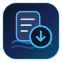

<div align="center">

<p>🌐 &nbsp; <strong>简体中文</strong> &nbsp;·&nbsp; <a href="README.en.md">English</a></p>



# 苍蓝流笺——拖拽发图与原生文件标签

**零 `app.asar` 侵入 · 零 Token 前缀税 · Antigravity 拖拽原生标签 & 剪贴板无损 PNG 落盘插件**

<p>
  
  
  
  
  <a href="./LICENSE"></a>
</p>

</div>

面向 **Google Antigravity** 的轻量输入增强插件（纯 Sidecar + 本机 CDP 守护，零第三方 npm 依赖；默认 0 工具 0 Token 前缀税，开启左侧栏快捷入口时按需注册 1 个轻量导航入口）。

## 核心特性

1. **拖拽文件 / 文件夹 → 插入原生青色标签（`📁 文件夹/` · `📄 文件`）**
   - 直接调用 `window.electronNative.getPathForFile(file)` 0ms 精确获取路径，并通过 Antigravity Lexical 原生 `contextScopeItemMention` 渲染为清爽的青色文件/文件夹标签（默认不附完整路径，支持在侧栏独立开启“标签后附带完整路径”、开启“插入后自动补一个空格”或一键切为纯文本绝对路径）。
   - **按住 `Shift` 拖拽**：自动放行给 Antigravity 原生附件机制。
2. **资源管理器 `Ctrl+C` / `Ctrl+V` 文件插入**
   - 在聊天输入框内粘贴资源管理器或聊天软件复制的本地文件与文件夹，直接生成原生标签或绝对路径。
3. **内存截图 `Ctrl+V` → 无损 PNG 落盘（告别聊天框糊图 JPG）**
   - 拦截聊天框原生有损图片压缩，通过本机 CDP `Runtime.addBinding` 私有通道将剪贴板原始图片字节无损写入 `~/.gemini/antigravity/pasted-images/`（PNG 原样直写零重编码），并自动在输入框插入原生文件引用。
4. **输入框 & 已发消息上方图片缩略图与无损高清灯箱（可开关）**
   - 粘贴、拖入或从画廊回插任意图片时，自动在输入框上方展示原生风格缩略图卡片；消息发出后，也会在已发消息气泡正上方右对齐保留同款圆角缩略图（不与原生图片附件重复叠加）。
   - 点击任意缩略图即可弹出无损高清大图灯箱（支持滚轮缩放、拖拽平移、双击切换 1:1 原图、多图切换、复制路径与系统看图器打开）；点输入框缩略图右上角 `×` 联动删除对应标签。
   - **流式零卡顿与后台休眠（`v1.0.1+`）**：本地缩略图与灯箱通过 Sidecar 一次性签名票据 HTTP 流式接口加载（不再经 CDP 塞入巨型 Base64 字符串），无图片消息零强制布局测量，窗口切到后台隐藏时巡检与 DOM 监听自动休眠。
5. **顶栏文件路径面包屑右键菜单（可开关）**
   - 在右侧栏打开文件/文件夹视图的顶部路径面包屑（`c: › Users › ...`）任意路径段上点击右键，可一键「引用到输入框」「打开此文件夹」「打开所在文件夹（定位选中）」或「复制路径」。
6. **苍蓝玻璃截图画廊 & 自动清理**
   - 侧栏实时展示最近无损落盘的截图缩略图、体积与时间，支持一键「插回输入框」、复制绝对路径、删除、打开目录及按天数自动清理过期旧图。
   - 融入苍蓝统一 Neko Glass 视觉与跨插件主题色调中心（`~/.gemini/azure-theme.json`）。

## 快速安装

> 前置要求：**Node.js >= 22.0.0**；启动 Antigravity 时请确保携带 `--remote-debugging-port=0`（与其他本地 CDP 调试工具共用同一端口，无需改 `app.asar`）。

```powershell
# Windows (PowerShell)
git clone https://github.com/A16Nights/antigravity-azure-drop.git "$env:USERPROFILE\.gemini\config\plugins\azure-drop"

# macOS / Linux
git clone https://github.com/A16Nights/antigravity-azure-drop.git ~/.gemini/config/plugins/azure-drop
```

重启或重载 Antigravity（`Ctrl+R`），在 **Plugins** 中启用 **苍蓝流笺** 即可自动连接主窗口生效。

## 数据存储

- **插件配置与统计**：`~/.gemini/azure-drop/config.json`、`~/.gemini/azure-drop/stats.json`
- **默认无损截图落盘目录**：`~/.gemini/antigravity/pasted-images/`（可在侧栏自定义）
- **苍蓝套件共享主题 / 左侧栏**：`~/.gemini/azure-theme.json`、`~/.gemini/azure-sidebar-nav.json`
- **首次新手引导已读状态**：`~/.gemini/azure-onboarding.json`

## 苍蓝套件全家桶（Azure Suite）

**苍蓝套件（Azure Suite）** 10 款插件共享统一的 **Neko Glass 毛玻璃界面**、跨插件同步的 **苍蓝主题色调中心**（`~/.gemini/azure-theme.json`）以及可自由开关的 **左侧栏快捷入口**（`~/.gemini/azure-sidebar-nav.json`）：

| 插件 | 仓库 | 核心能力 |
| --- | --- | --- |
| ✦ **苍蓝协奏台——外部模型调度与省流** | [antigravity-external-orchestrator](https://github.com/A16Nights/antigravity-external-orchestrator) | 多渠道外部模型协同调度、自定义调度角色、容灾断路器、全链路监控与首次新手引导 |
| 🪐 **苍蓝星轨——原生菜单外接模型挂载** | [antigravity-azure-orbit](https://github.com/A16Nights/antigravity-azure-orbit) | 将外部大模型直接挂载进 Antigravity 左下角原生模型下拉菜单担任主脑 |
| 🧭 **苍蓝罗盘——Agent 预设与上下文监控** | [antigravity-azure-compass](https://github.com/A16Nights/antigravity-azure-compass) | Agent 工作模式预设中心、上下文水位监测与自动 /compact、苍蓝套件左侧栏总控 |
| 🏛️ **苍蓝回廊——会话与工作区管理** | [antigravity-azure-corridor](https://github.com/A16Nights/antigravity-azure-corridor) | 纯官方原生会话与工作区同步、FTS5 全文检索、自选快捷标签栏、跨工作区转移续聊与新手引导 |
| 🌌 **蓝汐——认知图谱长期记忆** | [antigravity-lanxi-memory](https://github.com/A16Nights/antigravity-lanxi-memory) | 五层纯 Markdown 真源记忆、CJK FTS5、潮汐遗忘曲线与交互式潮汐星海图谱 |
| 💎 **苍蓝魂匣——人设卡与分层记忆** | [antigravity-soul-md](https://github.com/A16Nights/antigravity-soul-md) | 多人设卡热切换、工作区专属绑定、外接模型智能防掉线锚点与分层文件记忆 |
| 💭 **思语中文——外接模型中文思考切换** | [antigravity-think-zh](https://github.com/A16Nights/antigravity-think-zh) | 外接推理模型内部思考简体中文 / 英文热切换、双通道防漂移与实时注入预览 |
| 🔮 **苍蓝棱镜——思维链观测与实时翻译** | [antigravity-azure-prism](https://github.com/A16Nights/antigravity-azure-prism) | 原生 MCP App 思维链实时观测、免密钥零 Token 机翻与外部模型双通道译文 |
| 🪄 **苍蓝魔杖——Windows 桌面与网页操控** | [antigravity-azure-wand](https://github.com/A16Nights/antigravity-azure-wand) | Windows 桌面与网页低打扰操控台、独立输入 15 状态 AI 光标、套装画廊混搭与外部光标导入 |
| 🍃 **苍蓝流笺——拖拽发图与原生文件标签** &nbsp;`✦ 当前仓库` | [antigravity-azure-drop](https://github.com/A16Nights/antigravity-azure-drop) | 零 `app.asar` 侵入、拖拽与粘贴插入原生文件标签、无损 PNG 截图落盘、图片缩略图灯箱与面包屑右键菜单 |

---

<div align="center">

📄 Released under the <a href="./LICENSE"><strong>MIT License</strong></a> · Crafted for <strong>Google Antigravity</strong>

</div>
